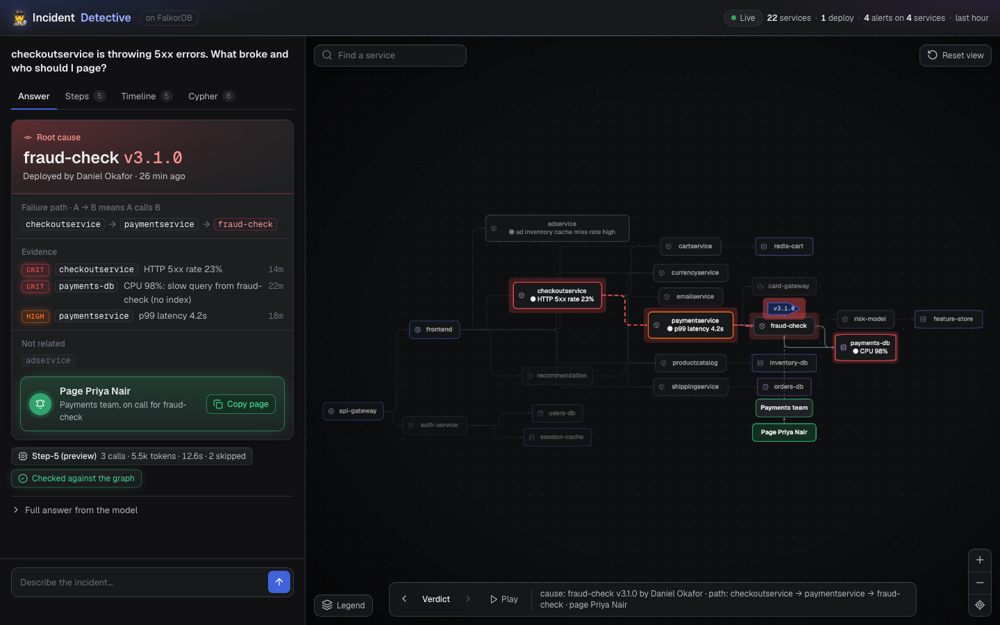
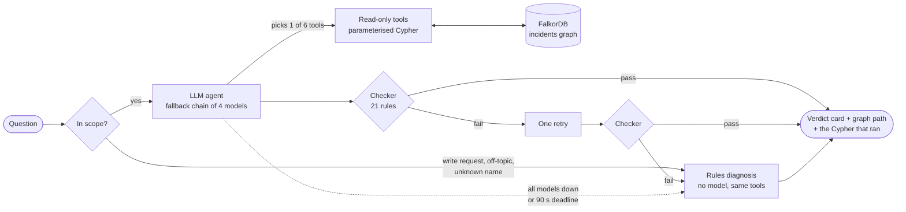
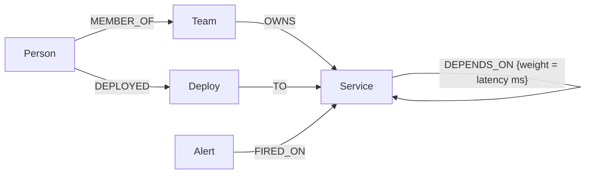

# Incident Detective

**An on-call agent that walks a [FalkorDB](https://www.falkordb.com/) graph to tell you what broke, why, and who to page, then checks its own answer against the graph before showing it.**

Built solo for Graph Hacks (WeMakeDevs × FalkorDB), Oct 15–18 2026. **Track 01: Agents That Act on Connected Data.**



*One question in. The root cause (`fraud-check v3.1.0`, deployed 26 minutes ago by Daniel Okafor), the call path it travelled to `checkoutservice`, the evidence, the unrelated alert, and the person to page. The graph on the right lights up the same path, and the green badge means the checker confirmed every claim against the graph.*

## The 30-second pitch

- **Problem.** At 3 a.m. the question is never "what is the CPU?". It is *which of the 20 services upstream is really at fault, did a deploy cause it, and who owns it?* That is a connected-data question: services call services, deploys land on services, alerts fire on services, teams own services.
- **How it works.** An LLM investigates through six fixed, read-only graph tools. It never writes Cypher. Every Cypher query that ran is shown next to the answer.
- **Why trust it.** A 21-rule checker compares every sentence of the answer with what the graph returned. Made-up people, services, versions, numbers, backwards dependencies and false "not in the graph" denials are caught. A bad answer gets one retry. If that fails too, a rules-only diagnosis answers with no model at all.

## Try it in five commands

You need Docker, Python 3.12 and at least one free LLM key (Groq, Gemini, NVIDIA, Mistral or OpenRouter). With **no key at all** the app still answers, using the rules diagnosis.

```bash
# 1. FalkorDB (the graph database)
docker run -d -p 6379:6379 --name falkordb falkordb/falkordb:v4.22.0

# 2. Python environment
python3.12 -m venv graph-hacks-env && source graph-hacks-env/bin/activate
pip install -r requirements.txt

# 3. API keys (any one is enough)
cp .env.example .env        # then paste a key into .env

# 4. Load the demo graph: 22 services, a live incident and a red herring
python seed.py

# 5. Run the app and open http://localhost:8765
uvicorn app:app --port 8765
```

Or ask from the terminal: `python agent.py "checkoutservice is throwing 5xx errors, what broke?"`

The incident is seeded relative to "now", so it is always recent. The app re-seeds on its own when the data is more than 30 minutes old (`AUTO_RESEED=0` turns that off). To use FalkorDB Cloud instead of Docker: `FALKORDB_URL=<your cloud url> python seed.py`, then run the app with the same variable.

### Questions worth asking

| Ask | What it shows |
|---|---|
| `checkoutservice is throwing 5xx errors. What broke and who should I page?` | Root cause, failure path, evidence, who to page |
| `What breaks if payments-db goes down?` | Blast radius: every service that depends on it, by hops |
| `Which services are most critical?` | Chokepoints by betweenness centrality |
| `Is the adservice alert related to the checkout errors?` | A red herring: the alert has no path to checkout |
| `Does payments-db depend on checkoutservice?` | Direction matters: it is the other way round |
| `billing-service is down, who do I page?` | A service that does not exist: the agent says so and pages nobody |
| `Is Sarah Jenkins on call for payments?` | A person who does not exist: never invented |
| `Should we roll back fraud-check v3.1.0?` | A yes or no with the evidence behind it |

## How it works



1. **Scope.** Write requests ("delete all alerts"), off-topic chat, and questions whose only graph names are unknown are answered by rules straight away, with no model call.
2. **Agent.** The LLM sees six tool schemas and calls them (at most 8 rounds). Providers are tried in order (Groq Qwen 3.8 → Gemini 3.1 Flash-Lite → StepFun Step-5 → NVIDIA Nemotron 3 Super), so one rate limit cannot stop an answer. How the chain was chosen: [docs/MODEL_EVALUATION.md](docs/MODEL_EVALUATION.md).
3. **Checker.** [`verify.py`](verify.py) reads the answer next to the raw tool results. See [what it catches](#the-checker).
4. **Fallback.** [`diagnose.py`](diagnose.py) works out the same answer with fixed rules over the same tools. It is labelled "Diagnosis by rules (no model)" in the UI, so you always know which path produced what you are reading.
5. **Card.** The UI turns the answer into a verdict card, draws the path on the graph, and shows every step with the Cypher behind it. The badge reads "Checked against the graph" only when a tool actually ran.

### The six tools

| Tool | Question it answers | FalkorDB feature |
|---|---|---|
| `dependencies` | What does X depend on? | Variable-length path `*1..8` |
| `blast_radius` | What breaks if X goes down? | Variable-length path, reversed |
| `recent_changes` | Which deploys and alerts landed recently? | Property filters on timestamps |
| `dependency_path` | How does A reach B, and at what latency? | `algo.SPpaths` (weighted shortest path) |
| `critical_services` | Which services are chokepoints? | `algo.betweenness`, `algo.pageRank` |
| `who_to_page` | Who owns X, and who is on call? | `OPTIONAL MATCH` over `OWNS` and `MEMBER_OF` |

All six run through `GRAPH.RO_QUERY` with a 3 s timeout, so the agent **cannot modify the graph** even if told to. Service names are validated first; an unknown name returns the list of real ones instead of an empty result.

## Why FalkorDB is essential

Take the graph away and there is nothing to answer from. The central question, *"which deploy explains this alert?"*, is a traversal: the alerting service → everything it depends on, any depth → the most recent deploy to any of them → the person on call for that deploy's team. In SQL that is a recursive CTE per question; in the graph it is one pattern. Three things only work because the data is a graph:

- **Root cause across hops.** The 5xx alert is on `checkoutservice`. The cause is a deploy to `fraud-check`, three hops away. Neither shares a team or an alert.
- **Red herrings.** The `adservice` alert fired at the same time. Declaring it unrelated is a *negative path result*: no `DEPENDS_ON` path in either direction.
- **Chokepoints.** "Most critical" is betweenness centrality, computed inside FalkorDB, not a hand-ranked list.

## Graph data model



| Node | Properties |
|---|---|
| `Service` | `name`, `tier` (edge, backend, data, external), `criticality` |
| `Team` | `name` |
| `Person` | `name`, `on_call` (boolean) |
| `Deploy` | `id`, `version`, `ts` (epoch ms), `status` |
| `Alert` | `id`, `severity`, `message`, `ts` (epoch ms), `resolved` |

The demo graph has **22 services, 5 teams, 15 people, 41 deploys, 14 alerts and 27 `DEPENDS_ON` edges**, based on Google's Online Boutique plus a payments chain. Everything is synthetic. The longest chain is `api-gateway → frontend → checkoutservice → paymentservice → fraud-check → risk-model → feature-store`. The seed ([`seed.py`](seed.py)) builds three stories:

- **A, the incident.** `fraud-check v3.1.0` (Daniel Okafor, 14 minutes before seeding) ships an unindexed query → `payments-db` CPU 98% → `paymentservice` p99 4.2 s → `checkoutservice` 5xx 23%. Page the Payments on-call, Priya Nair.
- **B, chokepoints.** Betweenness ranks `paymentservice` (65) and `checkoutservice` (63) first, then `fraud-check` (30).
- **C, the red herring.** An `adservice` cache-miss alert fires at the same time. It has no path to checkout.

## The Cypher the product depends on

These are the exact queries in [`tools.py`](tools.py). Parameters (`$name`, `$since`, …) are always passed separately, never pasted into the text.

```cypher
-- dependencies(X): everything X calls, nearest first (blast_radius reverses the arrow)
MATCH p = (s:Service {name: $name})-[r:DEPENDS_ON*1..8]->(x:Service)
RETURN x.name, min(length(p)) AS hops ORDER BY hops, x.name

-- recent_changes(): deploys and open alerts from the last hour
MATCH (p:Person)-[:DEPLOYED]->(d:Deploy)-[:TO]->(s:Service) WHERE d.ts >= $since
RETURN s.name, d.version, p.name, d.ts ORDER BY d.ts DESC LIMIT 20

MATCH (a:Alert)-[:FIRED_ON]->(s:Service) WHERE a.ts >= $since AND NOT a.resolved
RETURN s.name, a.severity, a.message, a.ts ORDER BY a.ts DESC LIMIT 20

-- dependency_path(A, B): weighted shortest path, with total latency
MATCH (a:Service {name: $a}), (b:Service {name: $b})
CALL algo.SPpaths({sourceNode: a, targetNode: b, relTypes: ['DEPENDS_ON'],
                   weightProp: 'weight'}) YIELD path, pathWeight
RETURN [n IN nodes(path) | n.name], pathWeight

-- critical_services(): chokepoints (or algo.pageRank('Service', 'DEPENDS_ON') for "most depended on")
CALL algo.betweenness({nodeLabels: ['Service'], relationshipTypes: ['DEPENDS_ON'],
                       samplingSeed: 42}) YIELD node, score
RETURN node.name, score ORDER BY score DESC LIMIT $limit

-- who_to_page(X): the owning team and its on-call person
MATCH (s:Service {name: $name})<-[:OWNS]-(t:Team)
OPTIONAL MATCH (p:Person {on_call: true})-[:MEMBER_OF]->(t)
RETURN t.name, p.name
```

Details that took testing against FalkorDB v4.22.0, worth knowing if you build on it: variable-length paths have no default upper bound, so every one is capped (`*1..8`); `algo.SPpaths` returns its weight as a float; `algo.betweenness` needs a `samplingSeed` to give the same ranking every time; and `algo.bfs` leaves out the start node.

## The checker

A fluent wrong answer is worse than no answer at 3 a.m. After the model writes its answer, [`verify.py`](verify.py) reads it next to the raw tool results and lists every claim the graph does not support. An empty list is a pass. The 21 rules fall into five groups:

| Group | What it catches | Example it caught |
|---|---|---|
| **Invented facts** (1–4, 6–10) | A person, service, team, version or number no tool returned | An on-call "Sarah Jenkins" who is not in the graph |
| **Wrong reasoning** (5, 5b, 17, 18) | An alerting service on the failure chain listed as "unrelated"; a root cause with no path to the failing service; "X depends on Y" backwards | "Yes, payments-db depends on checkoutservice" (it is the other way round) |
| **Questions about things that do not exist** (11–15) | A made-up service, version, person or team in the question that the answer does not call out; a real name wrongly called missing | "Did the paymentservice v2.0.0 deploy cause the latency?" answered as if v2.0.0 existed |
| **Skipped work** (16, 19, 20) | Graph facts with no tool call behind them; paging someone without looking at recent deploys; ranking "most critical" by anything but betweenness | An empty reply that said "I'll check…" and ran nothing |
| **Unanswered question** (21) | "Should we roll back X?" answered with a root cause and no yes or no | A rollback answer whose only "no" was in "(no index)" |

When a check fails, the model gets one retry with the problems listed. If the retry fails too, the rules diagnosis answers. The checker's own mistakes are tested too: the rules are run over all 456 saved model answers in [`docs/model-eval/`](docs/model-eval/) to look for correct answers it would wrongly reject.

Full rule list and how each was found: [docs/TESTING.md](docs/TESTING.md).

## Results

All numbers are from the code in this repository and can be reproduced with the commands below.

| Run | Cases | Passed | What it measures |
|---|---|---|---|
| Unit tests | 247 | 247 | Tools, checker, routing, card, no-key path |
| Edge-case suite, no models (rules only) | 62 | 62 | Deterministic answers from the rules diagnosis |
| Edge-case suite, live models | 62 | 62 | Full chain: real LLMs, checker, retry, card |
| Checker over saved model answers | 456 | 31 flagged | Possible false positives (see note) |

**Live run, 16 Oct 2026, 62 cases answered:** StepFun Step-5 answered 38, the rules diagnosis 17 (write requests, off-topic, unknown names, or every model rate-limited), Nemotron 6, Qwen 1. Groq and Gemini were out of free quota that day, so this run did not exercise them.

**Read by hand:** every live answer was read, not only graded by keyword. No wrong fact was found in the final run; the weak spots below are listed. Earlier runs did contain wrong answers (checkoutservice listed as "unrelated" to a `fraud-check` root cause; a rollback answer with no yes or no). Both are now caught by rules 5b and 21, and their saved cases pass.

**The 31 flags** are saved answers the checker rejects. They have not all been reviewed by hand yet, so this number is not yet a measure of false positives. The list is reproducible with `python -m scripts.checker_scan`.

**Known weak spots in the final run** (read by hand, not wrong facts): the C2 answer names no person to page ("use who_to_page"), the A10 rules answer does not page anyone for the cartservice failure, and the C3 card's "Not related" chips list the payments chain. Those are open items.

Raw run outputs: [`docs/model-eval/edge_live_2026-10-16.jsonl`](docs/model-eval/edge_live_2026-10-16.jsonl) and [`docs/model-eval/edge_rules_2026-10-16.jsonl`](docs/model-eval/edge_rules_2026-10-16.jsonl). Each row holds the question, answer, tool steps and Cypher, so every claim can be traced.

```bash
python -m pytest -q                                            # unit tests, no network
python evals/edge_cases.py http://localhost:8765 out.jsonl     # 62-question suite against a running app
```

The 62 questions cover the three stories (14), red herrings (3), blast radius (5), dependency paths and directions (5), criticality (2), owners and on-call (7), people (3), rollback (2), **false premises the agent must reject (11)**, out-of-scope questions (7), and write or injection attempts (3). Each answer is graded on its text, on the verdict card, and on the "checked" badge.

## Limitations

- **The data is synthetic.** One graph, three stories. The suite shows the agent behaves on this graph, not on yours.
- **The suite grades by keywords.** A keyword can pass a wrong answer. In the last run an answer listed `checkoutservice` as unrelated and still passed the grader; reading every answer by hand found it, and rule 5b now catches it. All answers in the results above were read by hand as well.
- **The checker only knows what the tools return.** It cannot tell that an answer is badly worded or leaves out something useful, only that a claim is unsupported.
- **Free tiers move.** Groq's free tier allows 200,000 tokens a day; once that is spent the chain continues on the next provider, which is slower. Model rankings were measured on one day from India.
- **The agent only reads.** It cannot restart a service, roll back, or page anyone. It tells you who to page.
- **No metrics.** The graph holds structure, deploys and alerts. Asked for CPU or memory, the agent says so rather than guess.

## Repository map

| Path | What it is |
|---|---|
| [`seed.py`](seed.py) | Builds the demo graph (re-runnable) |
| [`tools.py`](tools.py) | The six read-only tools and their Cypher |
| [`agent.py`](agent.py) | LLM loop, provider fallback chain, retry, deadlines |
| [`verify.py`](verify.py) | The 21-rule checker |
| [`diagnose.py`](diagnose.py) | Rules-only diagnosis (no model) and request routing |
| [`app.py`](app.py), [`static/index.html`](static/index.html) | FastAPI server and the single-page UI |
| [`evals/edge_cases.py`](evals/edge_cases.py) | The 62-question end-to-end suite |
| [`bakeoff.py`](bakeoff.py), [`scripts/`](scripts/) | Model selection harness |
| [`tests/`](tests/) | Unit tests |
| [`docs/`](docs/) | [Model evaluation](docs/MODEL_EVALUATION.md), [testing and checker rules](docs/TESTING.md), raw model answers |

Configuration is by environment variable: `GROQ_API_KEY`, `GEMINI_API_KEY`, `NVIDIA_API_KEY`, `MISTRAL_API_KEY`, `OPENROUTER_API_KEY` (any one), `FALKORDB_URL` (defaults to local Docker), `GRAPH_NAME`, `LLM_PROVIDER` and `LLM_MODEL` (pin one model, no fallback), `AUTO_RESEED`, `LOG_LEVEL`. See [`.env.example`](.env.example).

## Choosing the model

We didn't pick the LLM by reputation. We tested **all 218 models** our five free API keys could reach (Groq, Gemini, NVIDIA, Mistral, OpenRouter): first a one-request probe of each, then **35 models** through the real agent on the three demo incidents, graded on whether they named the right root cause, paged the right person, and never stated a wrong fact.

**10 models answered every question correctly.** The best six then answered **15 questions × 3 rounds**, including trap questions where the right answer is "that service doesn't exist" or "the graph has no CPU data". Only Groq Qwen 3.8 27B and NVIDIA Nemotron 3 Super got all 45 right. The fastest model, Mistral Codestral (1.9 s), blamed a deploy that doesn't exist when the question didn't name a service, so it was left out.

Full method, results, free-tier limits and how to rerun it: **[docs/MODEL_EVALUATION.md](docs/MODEL_EVALUATION.md)**. Raw answers: [docs/model-eval/](docs/model-eval/).

## AI usage

Built with **Claude Code** (Anthropic) as a coding assistant for planning, research, code drafting, test writing and review. Commits it helped write carry a `Co-Authored-By: Claude` trailer. Claude Code also wrote the first draft of the web UI and the adversarial question sets, and helped write the checker rules. Each of those was run, read and corrected by me against the real graph.

What I did myself: idea and track choice, graph model, dataset design, demo scenarios and their expected answers, choosing and verifying the graph algorithms, testing every query against FalkorDB, and reading every answer in the final test run.

The product itself calls LLMs at run time (the fallback chain above). They only choose which of the six tools to call and write the answer; the graph supplies the facts and the checker verifies them.

Design notes were prepared before Oct 15; all code was written during the event.
